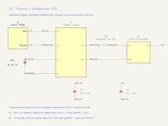
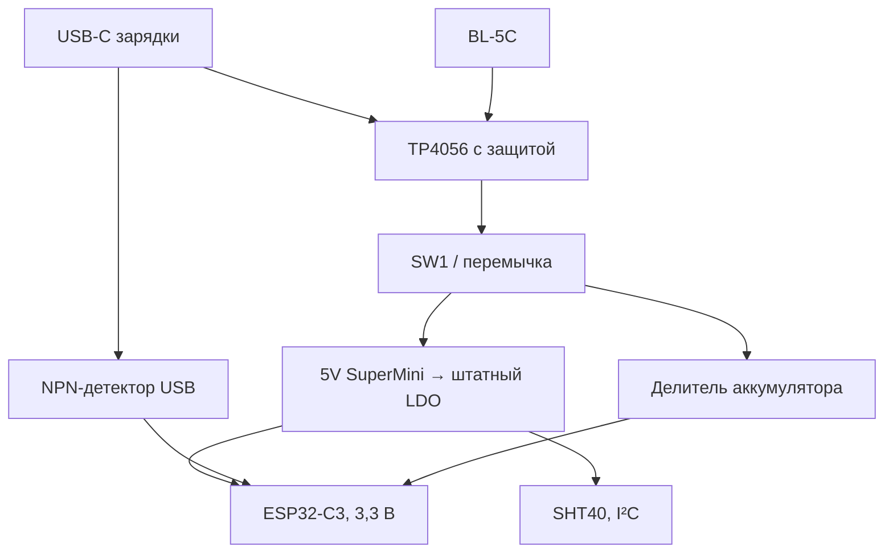
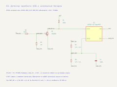

# Соединения и проверка первого прототипа

Это схема **для стендовой проверки**, а не подтверждение работоспособности конкретной партии RadioStack. Основной вариант: BL-5C → защищённый выход TP4056 → штатный LDO SuperMini. Отдельный повышающий преобразователь не предполагается. HT7333 не выбран заменой.

[Шесть электрических схем с пояснениями](SCHEMATICS.md) · [Все листы в PDF](schematics/termokontur-circuits.pdf) · [Исходники KiCad](../../hardware/sensor/README.md).

## Питание

| Откуда | Куда |
|---|---|
| Контакт `+` BL-5C | `B+` TP4056 |
| Контакт `−` BL-5C | `B−` TP4056 |
| Средний контакт BL-5C | Не подключён; назначение проверить по конкретной батарее |
| `OUT+` TP4056 | Выключатель/съёмная перемычка SW1 → сеть `VBAT_SW` |
| `VBAT_SW` | Вход `5V` SuperMini |
| `OUT−` TP4056 | Общая земля устройства → `G` SuperMini |
| `3.3` SuperMini | `VIN` SHT40 |
| Общая земля | `GND` SHT40 |
| GPIO6 | SDA SHT40 |
| GPIO7 | SCL SHT40 |

`B−` и `OUT−` не объединять дополнительным проводом: это может обойти защитные ключи типовой платы. Все дополнительные цепи относятся к `OUT−`. Входной минус USB на конкретном TP4056 должен быть проверен прозвонкой относительно `OUT−` перед монтажом детектора.

На схеме указаны функциональные связи. Точные соединения и общие земли заданы таблицами ниже.

## Детектор зарядного кабеля: GPIO4, активный ноль

| Элемент / узел | Соединение |
|---|---|
| Q1, NPN 2N3904, эмиттер E | Общая земля `OUT−` |
| Q1, коллектор C | GPIO4 |
| R1, 100 кОм | GPIO4 ↔ `3.3` SuperMini |
| R2, 100 кОм | Вход `IN+` TP4056 (5 В от зарядного USB) ↔ база B Q1 |
| R3, 1 МОм | База B Q1 ↔ эмиттер E / общая земля |

При наличии 5 В Q1 тянет GPIO4 вниз. При отсутствии USB GPIO4 подтянут к собственному питанию ESP. Источник 5 В не соединён с GPIO резистивным делителем. При SW1=OFF коллекторная подтяжка также обесточена; схема не предусматривает прямой подачи USB-напряжения на не питаемый GPIO. Проверить остаточное напряжение и ток при OFF на собранном экземпляре.

Ориентацию E/B/C брать из datasheet именно купленного транзистора, не из универсальной картинки. Для SMD возможен MMBT3904, но его корпус/распиновка отличаются. Прошивка включает внутреннюю подтяжку GPIO4 вверх и сохраняет её в глубоком сне. Плата просыпается при изменении уровня на входе зарядки.

## Напряжение аккумулятора: GPIO3

| Элемент | Соединение |
|---|---|
| R4, 1 МОм, 1% | `VBAT_SW` ↔ GPIO3 |
| R5, 1 МОм, 1% | GPIO3 ↔ общая земля |
| C1, 100 нФ | GPIO3 ↔ общая земля |

При 4,2 В на аккумуляторе расчётное напряжение ADC — 2,1 В; ток делителя — 2,1 мкА. Делитель находится **после SW1**. Постоянная времени — примерно 50 мс; прошивка ждёт 500 мс перед измерением и усредняет 16 отсчётов с калибровкой ESP-IDF. Эта задержка входит в реальное активное потребление, её нельзя исключать из расчёта батареи.

Начальный `adc_scale_ppm=2000000` соответствует делению 1:2. Уточнение по мультиметру: новый коэффициент = старый × реальное напряжение / показание устройства. Проверить минимум в трёх точках 3,4/3,8/4,2 В. Точность высокоомной цепи, утечки GPIO/конденсатора и режим ADC требуют стендовой проверки.

## Развязка, светодиоды, SHT40

- Посадочные места под дополнительные 47 мкФ на `VBAT_SW`/GND и 47 мкФ на `3.3`/GND возле SuperMini. Это стартовые номиналы, не замена осциллограмме. Использовать подходящие по напряжению компоненты; для MLCC учитывать падение эффективной ёмкости под смещением. Для LDO проверить допустимые C/ESR по фактической микросхеме.
- На SHT40 по фото есть подтяжки I²C и керамический конденсатор; проверить фактическую плату. Если подтяжек нет — добавить по 4,7–10 кОм от SDA и SCL к 3,3 В. Внутренние подтяжки MCU намеренно не используются.
- После проверки штатной работы можно отключить светодиод **питания** SuperMini, измерив разницу. Не выпаивать произвольный компонент по похожей картинке. Светодиод GPIO8 программа держит выключенным; реальные утечки во сне проверяются прибором.
- SHT40 оставить постоянно подключённым к 3,3 В: отдельное выключение GPIO-питанием не требуется для первого прототипа. Встроенный нагреватель SHT40 не используется.
- Датчик расположить у вентиляционного отверстия корпуса, вдали от TP4056 и аккумулятора. Под антенной не размещать металл батареи, проводники или крепёж. Не закрывать отверстие чувствительного элемента клеем.

## BOM сверх заказанных модулей

| Компонент | Количество на устройство | Примечание |
|---|---:|---|
| 2N3904 | 1 | Детектор USB |
| 100 кОм | 2 | Детектор USB |
| 1 МОм | 3 | 2 в ADC, 1 база–эмиттер |
| 100 нФ | 1 | Фильтр ADC |
| 4,7 кОм | 0–2 | Подтяжки выбранного интерфейса, если их нет на модуле |
| 100 нФ у датчика | 0–1 | Развязка, если её нет на модуле |
| 47 мкФ | 2 места | Фактические номиналы уточняются по питанию |
| Выключатель или съёмная перемычка | 1 | Отключает внешний плюс при сервисной прошивке |
| Резистор RPROG TP4056 | По фактической плате | Уменьшение тока заряда после идентификации чипа |
| Контакты/держатель BL-5C, провода, изоляция | Комплект | Предпочтительно разъёмные контакты батареи |

Без подтверждения стабилизатора покупка отдельного LDO/DC-DC не требуется. Базовая схема SuperMini указывает ME6211; реальная плата может содержать замену. Для ME6211C33 SOT23-5 паспортные typical dropout: около 120 мВ при 100 мА и 260 мВ при 200 мА; для более высокого Wi-Fi-тока эти цифры не гарантируют выход 3,3 В. 500 мА — не безусловная непрерывная возможность при любом входе, температуре и разводке.

## Зарядка TP4056

По фотографии номинал RPROG и производитель U1 не подтверждены. Сначала прочитать код резистора и маркировку U1. У распространённого варианта зависимость приблизительно `Icharge(мА) ≈ 1200 / Rprog(кОм)`; 3,9 кОм соответствовали бы около 308 мА. Это **пример**, не инструкция вслепую: сверить datasheet фактического совместимого чипа и измерить ток. Стартовая цель 300–400 мА не заменяет допустимый ток конкретного BL-5C.

TP4056 на фото не является контроллером полноценного power-path. Сон ESP уменьшает нагрузку, но завершение заряда и нагрев всей сборки всё равно проверяются. SW1 позволяет заряжать полностью выключенное устройство. Не паять к аккумулятору без необходимости; использовать контакты/держатель и проверить полярность по маркировке/мультиметру.

## Что измерить до постоянной сборки

1. Прозвонить VBUS USB SuperMini ↔ `5V`, вход LDO ↔ `5V`, `3.3` ↔ выход LDO. Проверить диоды/перемычки, а не считать схему клона точной копией.
2. Проверить детектор: GPIO4 high без зарядного кабеля, low с кабелем; при выключенном внешнем питании USB не поднимает линию 3,3 В. Проверить оба положения SW1 с питанием зарядки и без него.
3. Подать лабораторное питание через `5V` при отключённом USB SuperMini. Проверить 4,2/4,0/3,8/3,6/3,4/3,2 В, минимум 20 сеансов Wi-Fi/HTTPS в каждой точке. Осциллографом проверить `3.3`, brownout и запуск. Пока это не сделано, пороги прошивки — предварительные.
4. Измерить суммарный ток от аккумулятора: сон, запуск, SHT40, запись Flash, успешная/неуспешная сеть, OTA. Повторить со светодиодом питания и без него. Простого USB-тестера недостаточно для микроамперного сна и коротких RF-пиков.
5. Подключить зарядку посреди сна и сетевого обмена. Проверить остановку, отсутствие новых показаний и охлаждение после отключения. Проверить полное выключение/включение горячей сборки отдельно.
6. Измерить реальную полезную ёмкость BL-5C до **определённого испытанием рабочего порога**, а не до порога DW01. Просадка на Wi-Fi может ограничить полезную ёмкость раньше защиты батареи.
7. Только после этого фиксировать модули в корпусе и тестировать 3–5 суток в реальном кабинете.

## Автономность

При измерении **всего устройства на стороне аккумулятора** используйте:

`Qсут = 24 × Iсон + 48 × Qпробуждение + Qсеанс_WiFi + Qсаморазряд`

Здесь `Iсон` в мА; остальные слагаемые в мА·ч. `Qпробуждение` — интеграл дополнительного потребления сверх сна, включая ADC settling и Flash. Не добавлять повторно ток LDO/TP4056/делителя, если они уже вошли в измеренный `Iсон`.

`Дни ≈ Cполезная / Qсут`.

Для иллюстрации чувствительности, **не прогноза**, если полезная ёмкость 600 мА·ч и вся добавка сверх сна условно 1 мА·ч/сут:

| Ток сна всего устройства | Условный расход / сутки | Условная работа |
|---:|---:|---:|
| 50 мкА | 2,2 мА·ч | 273 суток |
| 100 мкА | 3,4 мА·ч | 176 суток |
| 300 мкА | 8,2 мА·ч | 73 суток |
| 700 мкА | 17,8 мА·ч | 34 суток |

Ёмкость 600 и добавка 1 здесь вымышленные входные допущения для расчётного примера, не измерения заказанной батареи. Для реальной оценки используйте `scripts/sensor-battery.py` с собственными значениями.

## Источники

- [WMNologo: SuperMini, питание и схема](https://wiki.nologo.tech/en/product/esp32/esp32c3SuperMini/esp32C3SuperMini.html).
- [Microne ME6211 datasheet, таблица ME6211C33](https://datasheet.lcsc.com/lcsc/1809141122_MICRONE-Nanjing-Micro-One-Elec-ME6211C50M5G-N_C236670.pdf).
- [ESP32-C3 datasheet](https://documentation.espressif.com/esp32-c3_datasheet_en.html).
- [Sensirion SHT4x datasheet](https://sensirion.com/media/documents/33FD6951/661CD142/HT_DS_Datasheet_SHT4x.pdf).
- [onsemi 2N3904](https://www.onsemi.com/download/data-sheet/pdf/2n3904-d.pdf).
