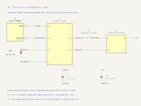
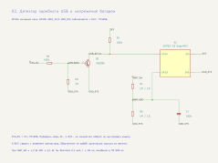
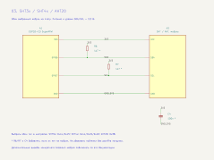
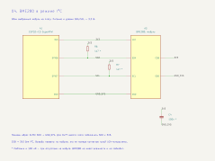
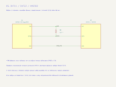
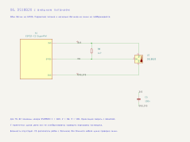

# Электрические схемы автономного датчика

Шесть монтажных схем выполнены в **KiCad 9** и сверены с GPIO прошивки 0.1.3.
[Скачать все шесть листов в PDF](schematics/termokontur-circuits.pdf).
[Редактируемые проекты KiCad](../../hardware/sensor/README.md).

Для одной сборки нужны листы **1 и 2**, а также **один** из листов 3–6.
Обозначение A1 на разных листах относится к одной и той же SuperMini.
Модули показаны по маркировке выводов: расположение контактов на рисунке
не задаёт их расположение на купленной плате. Это схемы соединений модулей,
не проект печатной платы и не внутренние схемы TP4056/SuperMini.

Проверка правил KiCad (ERC) и проверка экспортированных списков соединений
пройдены для всех шести листов. Электрические характеристики конкретных
модулей, работа питания, ток сна и тайминги требуют [проверки на стенде](BENCH.md).

## 1. Аккумулятор, TP4056, выключатель и питание ESP

`GND_SYS` — это `OUT−` защищённого модуля TP4056. Не соединяйте `B−` и `OUT−`
дополнительным проводом. Средний контакт BL-5C не подключён. `CHG_5V` берётся
с входа `IN+`, а не с аккумулятора. `USB_RETURN` показан отдельно: фактические
внутренние соединения отрицательных выводов TP4056 нужно проверить на модуле.

При подключении сервисного USB SuperMini разомкните SW1 и отключите USB
зарядки TP4056. Вывод `5V` SuperMini здесь используется как вход штатного LDO;
имя вывода не означает, что от аккумулятора на нём 5 В. Работоспособность LDO
при просадке батареи проверяется на реальной плате.

C2/C3 по 47 мкФ — места под дополнительную развязку, номиналы уточняются по
фактическому стабилизатору и осциллограммам. Если используются полярные
конденсаторы, плюс подключается к питающей сети, минус — к `GND_SYS`.

## 2. Детектор зарядки и измерение аккумулятора

Q1 с R1/R2/R3 преобразует наличие зарядных 5 В в активный ноль GPIO4.
Ориентацию выводов E/B/C определяйте по документации именно своего корпуса.
R4/R5/C1 подключаются после SW1: GPIO3 получает половину `VBAT_SW`.

При 4,2 В на входе делителя ожидается около 2,1 В на GPIO3. Для двух
резисторов по 1 МОм ток равен 2,1 мкА, сопротивление источника — 500 кОм,
постоянная времени с C1=100 нФ — 50 мс. Прошивка ждёт 500 мс перед отсчётами.
Это расчёт пассивной цепи, а не измеренная точность АЦП.

При питании от USB SuperMini `VBAT_SW` может получать напряжение с USB,
а на другой разводке показание делителя может оказаться нулевым. Такой
отсчёт нельзя принимать за напряжение аккумулятора. Первый рабочий прогон
проводите на штатном питании по [SETUP.md](SETUP.md#9-перейти-на-батарею-и-проверить-первый-обмен).

## 3. SHT3x, SHT4x и AHT20 — общий интерфейс I²C

Подключается один выбранный модуль. R6/R7 по 4,7 кОм и C4 100 нФ добавляйте,
если их нет на модуле. Уже установленные подтяжки не нужно автоматически
дублировать: параллельное соединение уменьшает суммарное сопротивление.

В настройке выберите реальное семейство. SHT3x: адрес 0x44/0x45; SHT4x:
0x44/0x45/0x46; AHT20: 0x38. Дополнительный ADDR у конкретного SHT3x-модуля
подключается по его документации; на рисунке показаны общие четыре вывода.

## 4. BME280: питание, I²C и выбор адреса

Показан адрес **0x76**: `SDO → GND_SYS`. Для адреса **0x77** замените это
соединение на `SDO → 3V3`; не соединяйте SDO с обеими сетями одновременно.
`CSB → 3V3` выбирает I²C. На некоторых модулях эти соединения уже сделаны.

Это обозначения контактов breakout-модуля, не номера контактов голой LGA-
микросхемы. Проверьте совместимость питания модуля с 3,3 В. BMP280 не является
заменой: влажность он не измеряет. Давление BME280 в проекте не используется.

## 5. DHT11 / DHT22 / AM2302

Схема относится к модулю, совместимому с питанием и логикой **3,3 В**.
Проверьте минимальное питание конкретного DHT11. Если требуется другое
питание, эта схема без дополнительного согласования уровней к нему
неприменима. Подтягивать GPIO ESP32 к 5 В нельзя.

R8 нужен, если его нет на модуле. Пины `VCC`, `DATA`, `GND` ищите по маркировке:
у голого датчика может быть четвёртый контакт `NC`, который не подключается.

## 6. DS18B20, один датчик с внешним питанием

DS18B20 получает отдельное питание VDD 3,3 В. Паразитный режим и несколько
датчиков на одной линии прошивка не поддерживает. R8 подтягивает DQ к 3,3 В;
C5 100 нФ располагается рядом с датчиком.

Для стандартного TO-92: **1 — GND, 2 — DQ, 3 — VDD**, но вид корпуса и порядок
слева направо сверяйте с datasheet. Цвета проводов герметичных щупов
не стандартизованы. Влажность у DS18B20 отсутствует.

## Проверки и исходники

- [Подключения, рассчитанные номиналы и аппаратные условия](HARDWARE.md).
- [Исходники KiCad, списки соединений и отчёты ERC](../../hardware/sensor/README.md).
- Генератор: `scripts/draw-sensor-schematics.py`.
- Стандартные обозначения взяты из библиотек KiCad: CC-BY-SA 4.0 с исключением
  для использования в проектах. [Условия библиотеки](https://www.kicad.org/libraries/license/).
