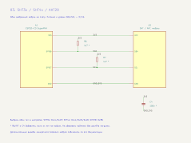
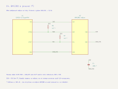
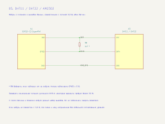
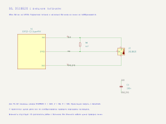

# Типы датчиков и замена модуля

Выберите тип модуля в USB-мастере или на странице настройки с телефона. Тип не определяется автоматически. На одной плате используется один модуль.

| Тип в настройке | Модели | Подключение | I²C-адреса |
|---|---|---|---|
| `sht4x` (по умолчанию) | SHT40/SHT41/SHT45 | SDA GPIO6, SCL GPIO7 | 0x44, 0x45, 0x46 |
| `sht3x` | SHT30/SHT31/SHT35 | SDA GPIO6, SCL GPIO7 | 0x44, 0x45 |
| `aht20` | AHT20 | SDA GPIO6, SCL GPIO7 | 0x38 |
| `bme280` | BME280 | SDA GPIO6, SCL GPIO7 | 0x76, 0x77 |
| `bmp280` | BMP280 | SDA GPIO6, SCL GPIO7 | 0x76, 0x77 |
| `dht11` | DHT11 | DATA GPIO5 | — |
| `dht22` | DHT22/AM2302 | DATA GPIO5 | — |
| `ds18b20` | DS18B20 | DQ GPIO5 | — |

Питание сигнальных цепей — 3,3 В, земля общая с ESP. Для I²C нужны внешние
подтяжки SDA/SCL к 3,3 В; для DHT и DS18B20 — 4,7 кОм от DATA/DQ к 3,3 В.
Проверьте допустимое питание конкретного DHT11: варианты и готовые модули
отличаются. Не подключайте подтяжки к 5 В. Питание батареи и GPIO3/4/8/9
остаются по [аппаратной инструкции](HARDWARE.md).

У BME280 и BMP280 выберите I²C-режим (CSB к 3,3 В, SDO к GND для 0x76 либо к 3,3 В
для 0x77). BMP280 измеряет температуру и давление, **но не влажность**;
Термоконтур использует только температуру. Давление BMP280/BME280 не передаётся.
Тип модуля выбирается вручную; драйвер при чтении проверяет chip ID:
BMP280 — 0x58, BME280 — 0x60. При несовпадении измерение отклоняется.
Данные температуры BMP280 соответствуют температуре самого кристалла датчика;
в тесном корпусе близость к нагревающимся элементам может искажать оценку
температуры воздуха. Желательно проверить расположение датчика на стенде.
У DS18B20 подключите VDD к 3,3 В:
паразитное питание и несколько устройств на одной линии не поддерживаются.

## Схемы подключения

Все варианты собраны в [галерее схем](SCHEMATICS.md) и [шестистраничном PDF](schematics/termokontur-circuits.pdf).

## Порядок замены

1. Передайте все накопленные измерения на сервер.
2. Отключите питание и замените модуль по схеме.
3. Для прошивки 0.1.4 или новее откройте USB-мастер и нажмите **Настроить без прошивки**.
4. Выберите новый тип, укажите параметры и сохраните.
5. Включите питание от аккумулятора и проверьте первые данные.

Для старого подключения по коду перевыпустите ключ в карточке и повторите [настройку с телефона](SETUP.md) с прежним ID и новым кодом.

Смена типа при неподтверждённых записях блокируется прошивкой, чтобы не
переинтерпретировать архив. В панели устройство показывает выбранный тип.
Аппаратный идентификатор протокола `c3-sht40-v1` сохранён для совместимости
существующего OTA; чувствительный элемент обозначается отдельным `sensor_type`.
Конфигурация хранится отдельно от образа, поэтому один OTA-образ подходит всем
перечисленным типам. Сервер запрещает sync с типом, отличным от регистрации.

DS18B20 и BMP280 отправляют `humidity: null`. В MQTT Discovery для них нет сущности
влажности (старое retained-объявление удаляется). У остальных типов влажность
обязательна; ноль процентов — допустимое измерение. Ошибки связи и CRC
передаются как ошибки, без фиктивных значений. Диапазон полного архива
−55…125 °C; основной журнал помещений сохраняет ограничение −40…60 °C.

Выбор типа влияет на расход батареи: DHT требует ожидания 2 с, DS18B20 —
конверсии до 750 мс; BME280 и BMP280 работают в forced mode. Оценки автономности SHT40
не переносятся на другие модели без измерений. Все новые драйверы требуют
проверки на физических модулях: запуск, CRC/обрыв, холодный старт,
сон/потребление и передача после накопления журнала.
