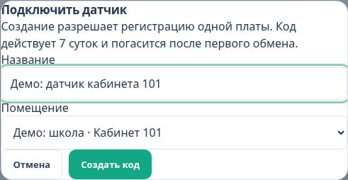
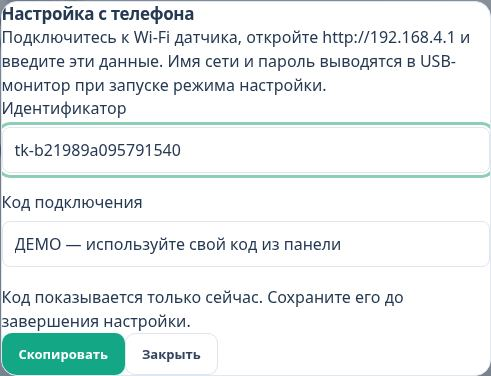
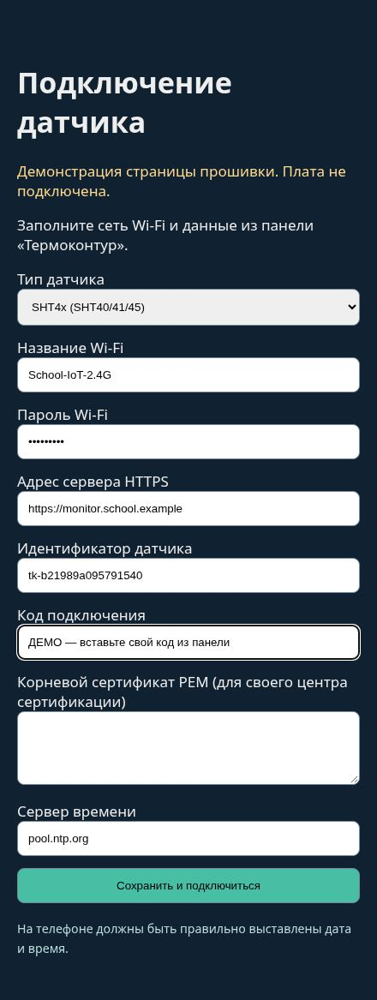
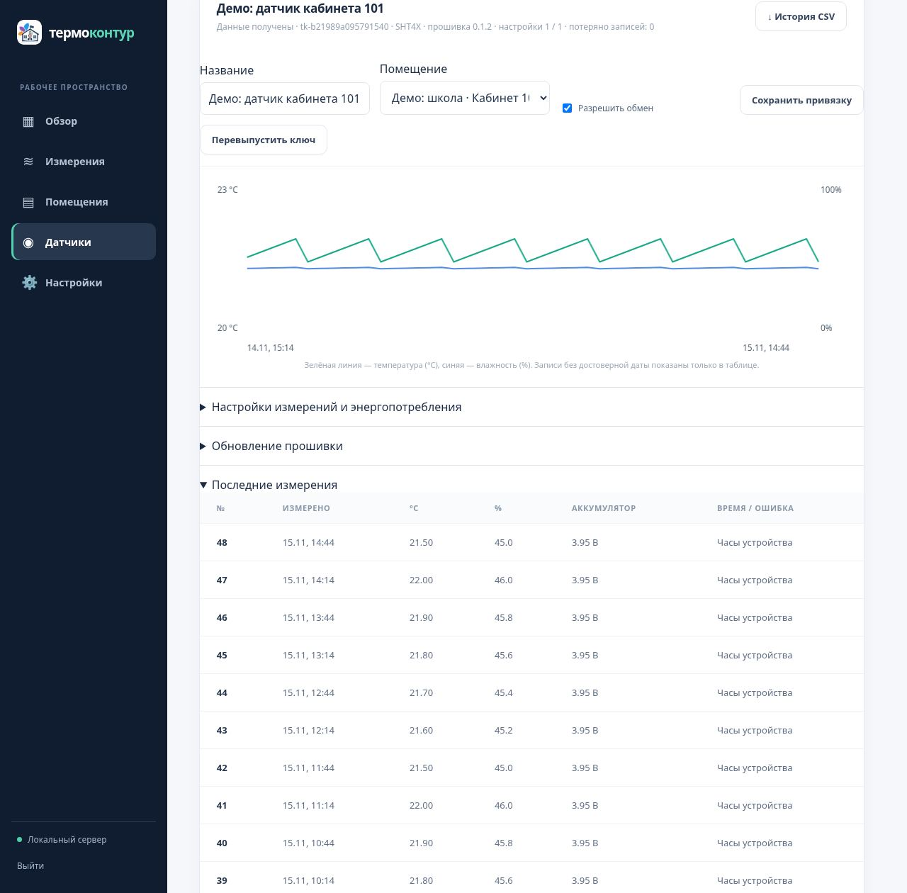
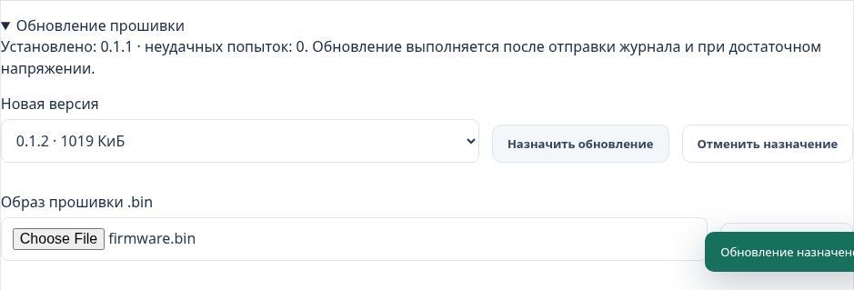

# Прошивка и настройка датчика

Рекомендуемый способ для прошивки 0.1.5 или новее — [подключение по USB из панели](USB-ONBOARDING.md). Ниже описана настройка через Wi-Fi датчика и ручная прошивка.

Нужна ESP32-C3 SuperMini с памятью 4 МБ и одним модулем: DHT11, DHT22, SHT3x, SHT4x, AHT20, BME280, BMP280 или DS18B20.

## Что подготовить

- Компьютер, USB-кабель с передачей данных и телефон.
- Собранную плату по [схеме](SCHEMATICS.md): модуль, BL-5C, TP4056 с защитой, SW1, делитель аккумулятора и детектор зарядки.
- Панель с поддержкой автономных датчиков, доступ администратора и активное помещение.
- Wi-Fi 2,4 ГГц и HTTPS-адрес панели, доступный из этой сети.
- Полный образ ESP32-C3 из **Датчики → Прошивки**. Для раздельной записи нужен ZIP из артефакта GitHub Actions `termokontur-sensor-esp32c3`.

Сначала обновите сервер, затем плату. USB-мастер добавлен в [PR №34](https://github.com/TeenKode/Termokontur/pull/34).

Адрес панели указывайте без пути API, например `https://monitor.school.example`. Для нестандартного порта: `https://monitor.school.example:8443`. Адреса localhost и 127.0.0.1 датчику не подходят.

Сертификат должен соответствовать имени или IP в адресе. Для собственного центра сертификации нужен корневой PEM. HTTP, сети с корпоративным входом и страницей авторизации не поддерживаются.

## Подключение модуля

Отключите питание перед монтажом. Земля общая, сигнальные подтяжки — к 3,3 В.

| Модуль | Подключение | Дополнительно |
|---|---|---|
| SHT3x, SHT4x, AHT20 | SDA → GPIO6, SCL → GPIO7, питание 3,3 В | Подтяжки SDA и SCL к 3,3 В |
| BME280 / BMP280 | SDA → GPIO6, SCL → GPIO7, питание 3,3 В | CSB → 3,3 В; SDO → GND для 0x76 или 3,3 В для 0x77 |
| DHT11, DHT22 | DATA → GPIO5, общая земля | Подтяжка DATA 4,7 кОм к 3,3 В; проверьте питание своей модели |
| DS18B20 | DQ → GPIO5, VDD → 3,3 В, общая земля | Подтяжка DQ 4,7 кОм; один модуль с внешним питанием |

GPIO3 занят делителем аккумулятора, GPIO4 — детектором зарядки. Не используйте GPIO3/4/8/9 для модуля. BMP280 и DS18B20 передают только температуру (`humidity: null`); давление BMP280/BME280 не передаётся.

[Схемы подключения](SCHEMATICS.md) · [PDF для печати](schematics/termokontur-circuits.pdf) · [Замена модуля](SENSOR-TYPES.md)

## Комплект прошивки

Полный бинарник для записи по адресу `0x0` доступен в **Датчики → Прошивки**. Для раздельной записи скачайте успешную сборку нужной ветки в **GitHub → Actions → Sensors**. Распакуйте артефакт, затем вложенный ZIP в отдельную папку.

| Файл | Назначение |
|---|---|
| `factory.bin` | Полный образ для браузерной записи по адресу 0x0 |
| `firmware.bin` | Обновление через карточку; при раздельной USB-записи — 0x20000 |
| `bootloader.bin` | Загрузчик, 0x0 |
| `partitions.bin` | Таблица разделов, 0x8000 |
| `ota_data_initial.bin` | Начальное состояние обновления, 0xf000 |
| `flash-sensor.py` | Проверка файлов и запись через Python |
| `manifest.json`, `SHA256SUMS` | Версия, исходный коммит и контрольные суммы |
| `images/`, `schematics/`, `hardware/` | Снимки интерфейса и схемы |

Используйте файлы из одного ZIP. Проверка в Linux: `sha256sum -c SHA256SUMS`. В PowerShell: `Get-FileHash .\factory.bin -Algorithm SHA256`; сравните результат с `SHA256SUMS`.

Полная прошивка перезаписывает настройки. Для работающего датчика используйте обновление через карточку. Для смены Wi-Fi стирать память не нужно.

## Ручная прошивка через браузер

1. Разомкните SW1 и отключите USB зарядки TP4056.
2. Подключите USB SuperMini к компьютеру. Закройте программы, занимающие порт.
3. Откройте [Espressif ESP Tool](https://espressif.github.io/esptool-js/) в Chrome или Edge на компьютере.
4. Нажмите **Connect** и выберите порт ESP32-C3.
5. Добавьте одну строку: `factory.bin`, адрес `0x0`. Параметры: DIO, 80 MHz, 4 MB, 115200 baud. Не включайте **Erase all**.
6. Нажмите **Program** и дождитесь успешной проверки записи.
7. Освободите порт, откройте USB-монитор на 115200 baud и перезапустите плату с отпущенной BOOT.

Если загрузчик не запускается: удерживайте BOOT, нажмите RESET, отпустите BOOT и повторите подключение.

Ручная запись `factory.bin` уничтожает настройки даже без Erase all. Часть старого журнала может сохраниться вне образа: не используйте этот способ как сброс работающего датчика.

## Ручная прошивка через Python

Выполняйте команды в распакованной папке комплекта. Питание подготовьте как для браузерной записи.

Windows, PowerShell:

```powershell
py -3 -m venv .venv
.\.venv\Scripts\python.exe -m pip install esptool==4.5.1
.\.venv\Scripts\python.exe -m serial.tools.list_ports
.\.venv\Scripts\python.exe flash-sensor.py --port COM5 --dry-run
.\.venv\Scripts\python.exe flash-sensor.py --port COM5
```

Linux или macOS:

```sh
python3 -m venv .venv
.venv/bin/python -m pip install esptool==4.5.1
.venv/bin/python -m serial.tools.list_ports
.venv/bin/python flash-sensor.py --port /dev/ttyACM0 --dry-run
.venv/bin/python flash-sensor.py --port /dev/ttyACM0
```

Замените порт своим: в Windows обычно `COM…`, в Linux — `/dev/ttyACM…` или `/dev/ttyUSB…`, в macOS — `/dev/cu.usbmodem…`. На Debian/Ubuntu для доступа может потребоваться группа `dialout` и повторный вход.

`--dry-run` проверяет файлы без записи. Перед прошивкой закройте USB-мониторы. После записи откройте монитор на 115200 baud.

## Имя сети и пароль датчика

Новая плата открывает режим настройки на 10 минут. В USB-мониторе появятся её имя сети, пароль и адрес:

```text
SETUP Wi-Fi: Termokontur-a1b2
SETUP password: 0123456789ab
Open http://192.168.4.1
```

Это пример. Используйте данные своей платы. Первый пароль случайный; общий пароль для всех плат отсутствует.

Открыть монитор через Python:

```powershell
.\.venv\Scripts\python.exe -m serial.tools.miniterm --dtr 0 --rts 0 COM5 115200
```

```sh
.venv/bin/python -m serial.tools.miniterm --dtr 0 --rts 0 /dev/ttyACM0 115200
```

Замените порт своим. Выход — **Ctrl+]**. Если пропустили начало вывода, нажмите RESET с отпущенной BOOT.

## Настройка с телефона

1. Подключитесь к сети `Termokontur-…` с паролем из USB-монитора. При сообщении «нет интернета» сохраните подключение.
2. Откройте `http://192.168.4.1`.
3. Укажите тип модуля, рабочий Wi-Fi, пароль и HTTPS-адрес панели.
4. В прошивке 0.1.5 время и сертификат поступают автоматически с указанного сервера. Телефону нужен доступ к серверу, браузеру — доверие к его сертификату.
5. Нажмите **Сохранить и подключиться**.

В прошивке 0.1.4 или новее ID и код можно оставить пустыми. После запуска от батареи датчик появится в **Ожидают разрешения**. Администратор сверяет плату и отпечаток ключа, выбирает помещение и нажимает **Разрешить**. Следующая попытка подключения — через 5 минут.

Для подключения по коду заранее откройте **Датчики → Подключить по коду**, задайте название и помещение. Сохраните ID и код до переключения телефона на сеть датчика, затем введите их в форме. Код действует 7 дней и используется один раз.







Снимки сделаны с демонстрационными данными; подписи старых версий могут отличаться. Страница телефона воспроизводит интерфейс прошивки без физической платы.

### Задать свой пароль точки настройки

В полях **Ваш пароль** и **Повторите ваш пароль** укажите 8–63 латинских символа, цифры или знаки. Пароль применяется при следующем входе в настройки и сохраняется после обновления прошивки.

Пустые поля сохраняют прежний режим. Флажок случайного пароля удаляет собственный пароль и включает генерацию при каждом запуске настроек. Текущий пароль можно прочитать в USB-мониторе.

Это пароль сети `Termokontur-…`. Пароль рабочего Wi-Fi и пароль администратора задаются отдельно.


## Первые измерения

1. Отключите USB SuperMini и USB зарядки TP4056.
2. Замкните SW1 для питания от аккумулятора.
3. В панели откройте карточку датчика и нажмите **Обновить**.
4. Дождитесь статуса **Данные получены**. Проверьте помещение, тип модуля, версию, напряжение и измерения.

Первое подключение выполняется сразу после настройки при достаточном заряде. Если данных нет, проверьте питание, Wi-Fi и HTTPS.



| Параметр по умолчанию | Значение |
|---|---|
| Измерение | Раз в 30 минут |
| Передача | Раз в сутки |
| Пауза после зарядки | 30 минут |
| Минимум для Wi-Fi | 3600 мВ |
| Нижний порог работы | 3300 мВ |
| Минимум для обновления | 3900 мВ |

Пороги проверьте на своей схеме. Пока USB зарядки подключён, измерения приостановлены. После отключения выдерживается пауза охлаждения, если плата наблюдала зарядку.

Начиная с 1.1.9 для проверки можно задать интервалы 5/5/0 с в **Измерения и питание**, отключить дополнительный порог Wi-Fi (0) и увеличить бюджет Wi-Fi. Передача и измерения планируются независимо. После испытания верните 1800/86400/1800 с и обычные пороги напряжения. Минимальный порог отключения аккумулятора 3000 мВ сохраняется. Проба BOOT при подключённом USB не зависит от порогов аккумулятора и расписания, не запускает OTA и отмечается как питание от USB. Зарядка по GPIO4 по-прежнему блокирует работу. Настройки применяются при следующем подключении и не будят спящий датчик. Сначала обновите прошивку, старые версии не принимают расширенные диапазоны.

С 1.1.10 тайм-аут HTTPS до 15 с в рамках общего бюджета Wi-Fi, до трёх сетевых попыток для bootstrap/sync, без повтора неоднозначно отправленных запросов регистрации. В режиме BOOT отключается modem sleep. I²C работает через современный драйвер ESP-IDF: штатно 100 кГц, повтор 50 кГц с внутренними подтяжками и soft reset для SHT3x/SHT4x. При ошибке USB-замера журнал показывает состояние SDA/SCL и результаты сканирования адресов. Пины остаются GPIO6/GPIO7; внешние подтяжки обязательны для штатной работы.

После аппаратной перезагрузки или полного отключения питания датчик при достаточном заряде запрашивает подтверждённое время у HTTPS-сервера до первого замера. При успешной проверке он измеряет температуру и использует тот же сеанс Wi-Fi для передачи накопленных данных. При недоступном сервере или недостаточном заряде он сохраняет замер в архиве. Календарный график учитывает только замеры с подтверждённым временем. При суточной передаче дата измерения может отличаться от даты получения.

## Обновление без USB

1. Сохраните резервную копию базы и обновите сервер.
2. В карточке откройте **Обновление прошивки**.
3. Выберите более новую версию из комплекта панели и нажмите **Назначить обновление**. Для своей сборки загрузите `firmware.bin` для ESP32-C3.
4. После следующего подключения проверьте установленную версию в карточке.



Обновление начнётся после передачи накопленного журнала, при достаточном заряде и без зарядки или охлаждения. Wi-Fi, тип модуля и журнал сохраняются. После трёх неудачных попыток устраните причину и назначьте обновление повторно.

Для обновления не подходят ZIP, `factory.bin`, `bootloader.bin` и `partitions.bin`. Аппаратный откат требуется проверить на стенде.

## Повторная настройка

Для прошивки 0.1.5 или новее используйте **Настроить без прошивки** в USB-мастере. Перед сменой типа или помещения передайте накопленные данные на сервер.

Для входа через телефон удерживайте BOOT не менее 3 секунд сразу после запуска приложения. Не держите BOOT во время RESET: это запускает загрузчик. Прочитайте имя сети и пароль в USB-мониторе.

Для старого подключения по коду перевыпустите ключ в карточке и используйте прежний ID с новым кодом. При замене самой платы или утрате её настроек отключите прежнюю запись и создайте новую. Не стирайте память ради смены Wi-Fi или пароля.

## Если данные не приходят

| Симптом | Что проверить |
|---|---|
| USB-порт не появляется | Кабель с данными, права доступа, BOOT/RESET |
| Порт занят | Закройте USB-мониторы и другие вкладки |
| Нет сети `Termokontur-…` | Вход в настройки через BOOT, зарядка TP4056 отключена |
| Страница 192.168.4.1 недоступна | Подключение к сети датчика, адрес HTTP; временно отключите VPN и мобильные данные |
| Пароль не принимается | 8–63 латинских символа, цифры или знаки; повтор должен совпадать |
| «Проверьте поля и получение времени сервера» | HTTPS-адрес, Wi-Fi и доступ браузера к серверу |
| `ADC/divider check required` | Цепь GPIO3 и коэффициент АЦП; проверяйте от батареи, не замыкайте SW1 при подключённом USB SuperMini |
| `wifi_unavailable` | Сеть 2,4 ГГц, пароль и уровень сигнала |
| `https_sync_failed` | Адрес, DNS, порт, сертификат, время и разрешение подключения |
| `time_required` | Повторная локальная настройка для получения времени сервера |
| `sensor_io` или `sensor_crc` | Тип модуля, питание, соединения и подтяжки |
| Во время зарядки нет измерений | Отключите зарядный USB и дождитесь паузы охлаждения |
| Обновление не начинается | Следующее подключение, передача журнала и достаточное напряжение |
| Давно нет связи | График передачи, питание, Wi-Fi и доступность сервера |

## Сборка из исходников

Из чистой копии нужной ветки:

```sh
python3 -m venv .venv
.venv/bin/python -m pip install platformio==6.1.18 esptool==4.5.1
.venv/bin/python scripts/package-sensor.py
```

На Windows используйте `py -3` и `.\.venv\Scripts\python.exe`. Первый запуск скачивает инструменты через интернет.

ZIP появится в `dist/termokontur-sensor-<версия>-<commit>-bench.zip`. Сборка и программные проверки не заменяют [испытания платы](BENCH.md).
