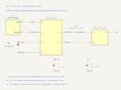
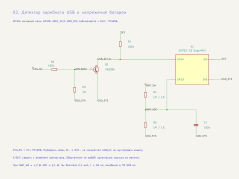
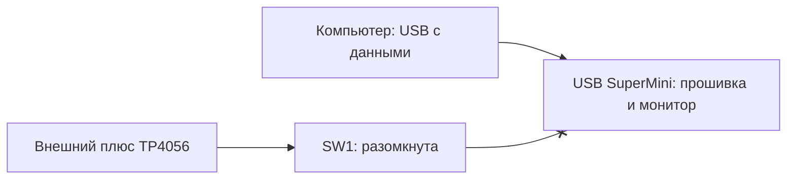
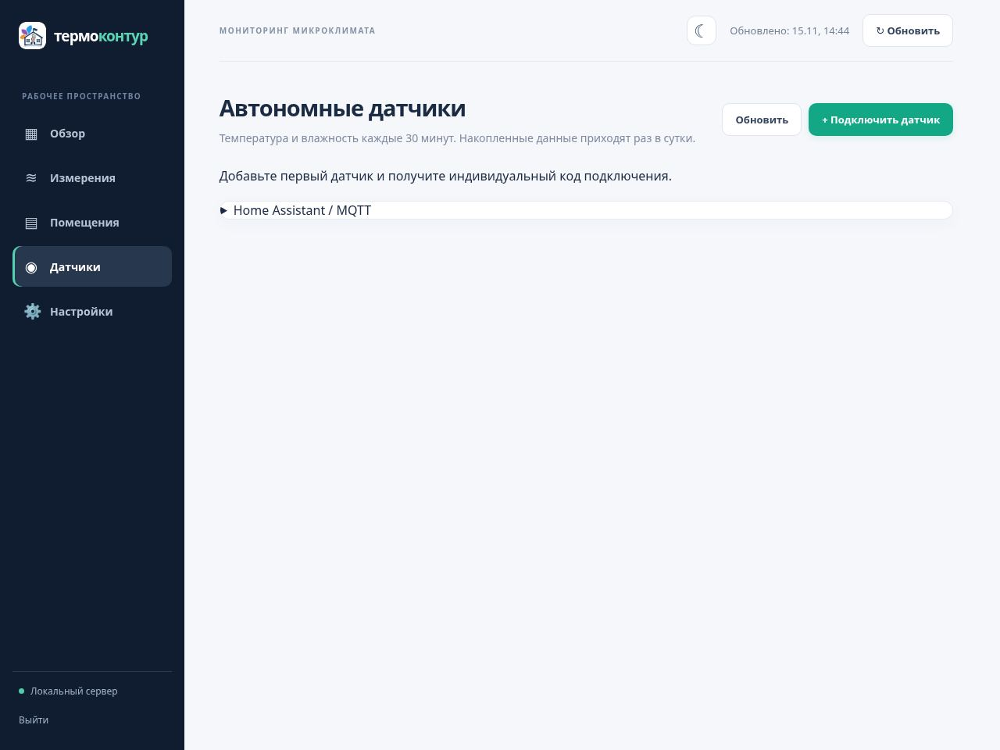
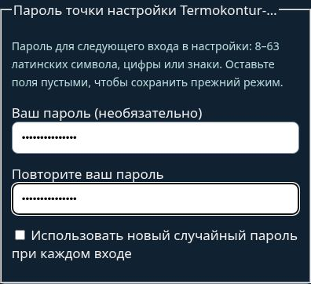
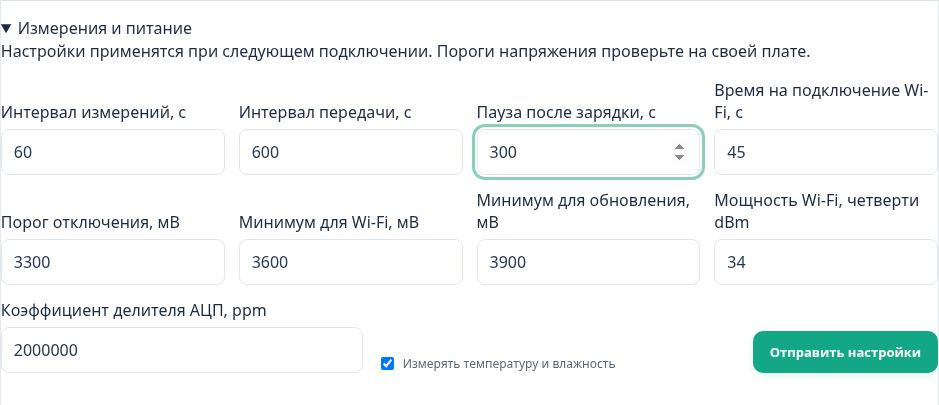
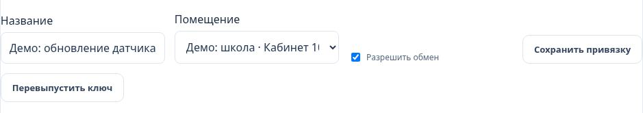

# Первая прошивка и настройка датчика «Термоконтур»

**Рекомендуемый способ для 0.1.4+: [прошивка на сайте и автоматическая авторизация по USB](USB-ONBOARDING.md).**

Руководство для ESP32-C3 SuperMini и универсальной прошивки **0.1.3**.
Поддерживаются DHT11, DHT22/AM2302, SHT3x, SHT4x, AHT20, BME280 и DS18B20.
На одной плате используется один выбранный чувствительный элемент.

Весь процесс: **подготовить панель → подключить модуль → прошить плату по USB
→ получить код в панели → настроить Wi-Fi с телефона → перейти на батарею
→ проверить первый обмен**. Home Assistant и MQTT для этого не нужны.

Прошивка и программные тесты проверены; физические платы и новые модули
ещё требуют [стендовой проверки](BENCH.md). Ниже описан порядок работы,
предусмотренный текущим кодом.

## 1. Что подготовить

- Компьютер Windows, Linux или macOS. Для браузерной прошивки — настольный
  Chrome/Edge с Web Serial. Телефон нужен для настройки Wi-Fi после прошивки.
- ESP32-C3 SuperMini с Flash 4 МБ и USB-кабель **с передачей данных**.
- Один из поддерживаемых датчиков и собранную схему питания/детектора USB/АЦП
  по [HARDWARE.md](HARDWARE.md). Одной платы ESP с модулем недостаточно для
  штатных измерений: прошивка проверяет аккумулятор и вход зарядки.
- Аккумулятор BL-5C, TP4056 с защитой и размыкаемую цепь внешнего плюса SW1.
- Доступ администратора к панели «Термоконтур» и созданное помещение.
- Сеть Wi-Fi 2,4 ГГц, её SSID и пароль; доступ из этой сети к HTTPS-панели.
- ZIP-комплект прошивки 0.1.3 целиком, а не один случайный `.bin`.

**Сначала обновите сервер, затем датчик.** Сервер должен поддерживать
автономные датчики и поле `sensor_type`. Пока изменения не включены в `main`,
они находятся в [PR #32](https://github.com/TeenKode/Termokontur/pull/32) и
[PR #33](https://github.com/TeenKode/Termokontur/pull/33). Установка старого
`main` сама по себе эти возможности не добавляет.

### Адрес панели

Пример адреса — `https://monitor.school.example`. Это пример, замените его
на свой рабочий адрес. Если используется нестандартный HTTPS-порт, укажите
его: `https://monitor.school.example:8443`.

Датчик обращается к панели напрямую. Адрес `localhost` или `127.0.0.1`
на датчике означает сам датчик и не подходит. Не добавляйте `/api/sensors`
или `/api/ingest`: прошивка добавляет нужные пути сама.

Сертификат должен подходить имени в адресе. Для собственного центра
сертификации подготовьте корневой сертификат в формате PEM. Одного нажатия
«продолжить» при предупреждении браузера недостаточно, чтобы ESP доверял
сертификату. Использовать HTTP или отключать проверку TLS прошивка не умеет.
Из сети датчика должны работать DNS и доступ к указанному HTTPS-порту.

Wi-Fi с веб-страницей авторизации и Enterprise/802.1X не поддерживается.
Для первой настройки используйте отдельную WPA2-Personal сеть 2,4 ГГц.

## 2. Подключить чувствительный элемент

Перед монтажом отключите питание. Все сигнальные подтяжки подключаются
к **3,3 В**, земля датчика и ESP общая.

| Выбранный тип | Соединение с SuperMini | Дополнительно |
|---|---|---|
| SHT3x, SHT4x, AHT20 | SDA → GPIO6, SCL → GPIO7, питание → 3,3 В | Внешние подтяжки SDA/SCL к 3,3 В; на модуле они могут уже быть |
| BME280 | SDA → GPIO6, SCL → GPIO7, питание → 3,3 В | I²C: CSB → 3,3 В; SDO → GND для 0x76 или → 3,3 В для 0x77 |
| DHT11, DHT22 | DATA → GPIO5, GND → общая земля | DATA подтянуть к 3,3 В резистором 4,7 кОм; питание конкретного DHT11 проверить по его документации |
| DS18B20 | DQ → GPIO5, VDD → 3,3 В, GND → общая земля | DQ подтянуть к 3,3 В резистором 4,7 кОм; только один DS18B20, внешнее питание |

У выводов модулей нет единого порядка. Смотрите подписи на своей плате;
не определяйте распиновку по цвету провода. BMP280 не заменяет BME280:
у BMP280 нет влажности. Давление BME280 эта прошивка не собирает.
DS18B20 измеряет только температуру; влажность для него будет отсутствовать.

GPIO3 используется для делителя аккумулятора, GPIO4 — для детектора USB
TP4056. Эти цепи должны быть собраны по аппаратной инструкции. Без зарядного
кабеля GPIO4 должен быть высоким. Для датчиков не используйте GPIO3/4/8/9.
Адреса I²C и подробности замены — в [SENSOR-TYPES.md](SENSOR-TYPES.md).

### Схемы для монтажа

Питание и входы детектора/АЦП обязательны при любом выбранном датчике:





Далее используйте **одну** подходящую схему:

- [SHT3x/SHT4x/AHT20](schematics/03-i2c.svg) — SDA GPIO6, SCL GPIO7.
- [BME280](schematics/04-bme280.svg) — GPIO6/7, CSB и SDO.
- [DHT11/DHT22](schematics/05-dht.svg) — DATA GPIO5, только совместимый с 3,3 В модуль.
- [DS18B20](schematics/06-ds18b20.svg) — DQ GPIO5 и отдельное питание VDD.

[Все схемы с пояснениями](SCHEMATICS.md) · [PDF для печати](schematics/termokontur-circuits.pdf).
Подписи выводов приоритетнее их расположения на рисунке. Схемы выполнены в KiCad;
проверка соединений не заменяет аппаратную приёмку по [BENCH.md](BENCH.md).

## 3. Получить и проверить комплект

В GitHub откройте **Actions → Sensors**, выберите успешную сборку нужной
ветки/ревизии и скачайте артефакт `termokontur-sensor-esp32c3`. Для скачивания
артефактов может потребоваться вход в GitHub. Распакуйте артефакт, затем
вложенный `termokontur-sensor-…-bench.zip` в отдельную папку.

Не используйте комплект из неуспешного запуска. Альтернативный путь —
сборка из исходников, описанная в разделе 12.

Внутри стендового ZIP должны находиться:

| Файл | Назначение |
|---|---|
| `factory.bin` | Первая установка через браузер: единый образ, адрес 0x0 |
| `firmware.bin` | Приложение: для штатного OTA; при раздельной USB-записи адрес 0x20000 |
| `bootloader.bin` | Загрузчик, адрес 0x0 при раздельной записи |
| `partitions.bin` | Таблица разделов, адрес 0x8000 |
| `ota_data_initial.bin` | Начальное состояние OTA, адрес 0xf000 |
| `flash-sensor.py` | Проверка комплекта и раздельная USB-запись через Python |
| `manifest.json`, `SHA256SUMS` | Версия, исходная ревизия, размеры и SHA-256 файлов |
| `SETUP.md`, `images/`, `schematics/`, `hardware/` | Руководство со снимками, схемы SVG/PDF и редактируемые исходники KiCad |

Используйте файлы из **одного ZIP**. В Linux проверить весь комплект можно
командой `sha256sum -c SHA256SUMS` в распакованной папке. В PowerShell
команда `Get-FileHash .\factory.bin -Algorithm SHA256` покажет сумму образа;
сравните её со строкой `factory.bin` в `SHA256SUMS`. `flash-sensor.py` также
проверяет суммы файлов комплекта перед записью.

### Выбор способа

Для новой платы выберите **один** способ: браузер в разделе 4 или Python
в разделе 5. Оба устанавливают загрузчик, разделы и приложение.

Для уже работающего датчика используйте **OTA из раздела 10**. Запись
`factory.bin` перезаписывает NVS с Wi-Fi, токеном и счётчиками даже без
Erase all. При этом старый журнал за пределами образа может сохраниться.
Такую запись нельзя считать безопасным сбросом уже используемой платы.
Не стирайте Flash ради повторной настройки Wi-Fi.

## 4. Первая прошивка через браузер

Схема ниже показывает только выбор питания при USB-записи. Это не схема
распиновки модулей; соединения сверяйте с [HARDWARE.md](HARDWARE.md).



1. Разомкните **SW1 / перемычку внешнего плюса TP4056 → SuperMini**.
   Отключите зарядный USB от TP4056. Подача питания для этого этапа — только
   через USB самой SuperMini. Убедитесь, что ваша разводка соответствует
   [HARDWARE.md](HARDWARE.md).
2. Подключите SuperMini к компьютеру кабелем с данными. Закройте Arduino
   Serial Monitor, PlatformIO monitor и другие программы, занявшие порт.
3. В настольном Chrome/Edge откройте
   [Espressif ESP Tool](https://espressif.github.io/esptool-js/).
4. Нажмите **Connect**, выберите порт ESP32-C3 и разрешите доступ. Если порт
   неизвестен, отключите/подключите плату и посмотрите, какой появился.
5. Если плата не входит в загрузчик автоматически: зажмите BOOT, нажмите
   и отпустите RESET, затем отпустите BOOT. Если кнопки RESET нет, подключите
   USB с зажатой BOOT, после появления порта отпустите её. Повторите Connect.
6. В списке файлов оставьте одну строку: **`factory.bin`, адрес `0x0`**.
   Параметры записи: **DIO, 80 MHz, 4 MB, скорость 115200 baud**. Если
   интерфейс предлагает Erase all, не включайте его.
7. Запустите Program/запись и дождитесь успешного завершения и проверки.
   При ошибке запись не считается законченной; проверьте кабель и порт.
8. Освободите порт в браузерном инструменте. Откройте последовательный
   монитор на 115200 baud и перезапустите плату с отпущенной BOOT, чтобы
   получить реквизиты точки настройки. Как открыть монитор — раздел 6.

Встроенной кнопки USB-прошивки в панели «Термоконтур» пока нет.
Браузерный инструмент записывает программу; Wi-Fi и регистрацию затем
настраивают через отдельную страницу самого датчика.

## 5. Первая прошивка через Python

Этот способ подходит, если Web Serial недоступен. Команды выполняются
на компьютере с подключённой SuperMini, в распакованной папке комплекта.
Подготовьте питание и BOOT/RESET так же, как в разделе 4.

### Windows, PowerShell

Установите Python 3, затем выполните:

```powershell
py -3 -m venv .venv
.\.venv\Scripts\python.exe -m pip install esptool==4.5.1
.\.venv\Scripts\python.exe -m serial.tools.list_ports
.\.venv\Scripts\python.exe flash-sensor.py --port COM5 --dry-run
.\.venv\Scripts\python.exe flash-sensor.py --port COM5
```

`COM5` замените фактическим портом из списка или «Диспетчера устройств».
`--dry-run` проверяет файлы и печатает команду, но ничего не записывает.
Перед последней командой закройте все последовательные мониторы.

### Linux или macOS

```sh
python3 -m venv .venv
.venv/bin/python -m pip install esptool==4.5.1
.venv/bin/python -m serial.tools.list_ports
.venv/bin/python flash-sensor.py --port /dev/ttyACM0 --dry-run
.venv/bin/python flash-sensor.py --port /dev/ttyACM0
```

На Linux порт обычно похож на `/dev/ttyACM0` или `/dev/ttyUSB0`, на macOS —
на `/dev/cu.usbmodem…`. Берите фактическое имя из списка, не копируйте пример
без проверки. Если нет доступа к порту, проверьте права своей учётной записи
на последовательное устройство; на Debian/Ubuntu обычно нужна группа
`dialout` и повторный вход в систему после изменения группы.

Ожидается успешная запись и проверка данных esptool. Скрипт не выполняет
`erase_flash`. После завершения откройте монитор из следующего раздела.

## 6. Получить имя Wi-Fi и пароль датчика

На первой загрузке новая плата сама открывает режим настройки. Не держите
BOOT во время обычной загрузки: так можно снова попасть в ROM-загрузчик.

Откройте монитор 115200 baud. Можно использовать терминал браузерного
инструмента либо Python-терминал из окружения предыдущего раздела:

```powershell
# Windows: заменить COM5 своим портом
.\.venv\Scripts\python.exe -m serial.tools.miniterm --dtr 0 --rts 0 COM5 115200
```

```sh
# Linux: заменить путь своим портом
.venv/bin/python -m serial.tools.miniterm --dtr 0 --rts 0 /dev/ttyACM0 115200
```

На macOS в последней команде используйте свой `/dev/cu.usbmodem…`.
Для выхода из miniterm нажмите **Ctrl+]**. Если пропустили начало вывода,
перезапустите плату кнопкой RESET с отпущенной BOOT; при смене USB-порта
переоткройте монитор.

Ожидаются строки вида:

```text
SETUP Wi-Fi: Termokontur-a1b2
SETUP password: 0123456789ab
Open http://192.168.4.1
```

Это пример: **имя и пароль для первого подключения берите из своего монитора**.
На новой плате пароль случайный. Начиная с прошивки 0.1.3 на странице настройки
можно задать свой пароль точки `Termokontur-…`: он будет использоваться при
следующих входах и сохранится после OTA. Имя точки по-прежнему меняется.
Если свой пароль не задан либо включён случайный режим, при каждом новом
запуске настройки генерируется новый пароль. Общего пароля партии нет.
Не публикуйте вывод с паролем, код регистрации и сертификат с закрытым ключом.
Для настройки нужен только открытый корневой PEM, без закрытого ключа.

Режим настройки работает **10 минут** и допускает подключение одного клиента.
Если срок истёк, перезапустите новую, ещё не настроенную плату и прочитайте
имя сети и актуальный пароль (свой сохранённый либо новый случайный). Держите зарядный USB TP4056 отключённым: при обнаружении
зарядки прошивка ставит работу, включая настройку, на паузу.

## 7. Создать запись датчика в панели

Снимки ниже сделаны на отдельном демонстрационном стенде. Названия, ID и
показания приведены для примера; код регистрации скрыт. Используйте свои
данные. Снимок страницы настройки телефона воспроизводит HTML прошивки,
а не подключение к физической плате.




1. Откройте панель администратора с компьютера или телефона, подключённого
   к обычной сети. Убедитесь, что нужное помещение уже создано и активно.
2. Перейдите **«Датчики» → «+ Подключить датчик»**.
3. Введите понятное название, например «Кабинет 101, у внутренней стены».
4. Выберите помещение и нажмите **«Создать код»**.
5. Сохраните **идентификатор `tk-…` и код подключения**. Они понадобятся на
   странице датчика. Код показывается один раз, действует 7 суток и гасится
   после первого успешного обмена. Если код потерян — используйте
   «Перевыпустить ключ» в карточке устройства.


Код из этого окна индивидуален. Общий ключ из «Настройки → Датчики и API»
для автономной прошивки не нужен: он относится к прежнему `/api/ingest`.

Удобно держать панель открытой на компьютере, а телефон использовать для
точки датчика. Если всё делаете одним телефоном, сохраните ID/код **до**
переключения на Wi-Fi датчика: у его точки нет доступа к интернету.

## 8. Настроить датчик с телефона

1. Откройте Wi-Fi телефона и подключитесь к `Termokontur-…` с паролем из USB-
   монитора. При сообщении «нет интернета» выберите «оставаться подключённым».
   Если телефон уходит на мобильную сеть, временно отключите мобильные данные
   и VPN, затем повторите подключение.
2. В браузере вручную откройте **`http://192.168.4.1`**. Именно HTTP:
   это локальная страница внутри защищённой Wi-Fi-точки. Автоматического
   перенаправления на неё нет.
3. Заполните поля:

| Поле | Что указать |
|---|---|
| Тип датчика | Реальный модуль: SHT4x для SHT40/41/45, SHT3x для SHT30/31/35, либо AHT20, BME280, DHT11, DHT22, DS18B20 |
| Название Wi-Fi | SSID рабочей сети 2,4 ГГц; это не `Termokontur-…` |
| Пароль Wi-Fi | Пароль рабочей сети; для открытой сети оставить пустым |
| Адрес сервера HTTPS | Полный адрес панели, при необходимости с портом; без пути API |
| Идентификатор датчика | `tk-…` из панели, полностью |
| Код подключения | Индивидуальный код из панели |
| Корневой сертификат PEM | Для собственного CA — текст открытого корневого сертификата с BEGIN/END CERTIFICATE; для доверенного публичного CA обычно пусто |
| Сервер времени | Доступный NTP: по умолчанию `pool.ntp.org`, в закрытой сети — свой сервер |
| Ваш пароль точки настройки | Необязательно: 8–63 печатных ASCII-символа (латиница, цифры, пробелы и знаки); будет применён при следующем входе в `Termokontur-…` |
| Повторите ваш пароль | Повторить заданный пароль точки настройки; два пустых поля сохраняют текущий режим |
| Использовать новый случайный пароль при каждом входе | Включить, чтобы удалить свой пароль и вернуться к генерации случайного при каждом запуске настройки |


4. Проверьте дату и время телефона: страница передаёт их в плату как
   начальную временную опору для проверки HTTPS.
5. Нажмите **«Сохранить и подключиться»**. При успехе страница сообщит
   о сохранении и перезапуске. Точка датчика исчезнет — это ожидаемо.
6. Верните телефон в обычную сеть и откройте панель.

Тип не определяется автоматически. Например, SHT3x и SHT4x могут отвечать
по одному I²C-адресу, но требуют разных команд.

### Задать свой пароль точки настройки

На странице есть **два разных пароля**. «Пароль рабочей Wi-Fi сети» нужен,
чтобы датчик подключался к школьной/домашней сети. Раздел «Пароль точки
настройки Termokontur-…» задаёт пароль сети, которую поднимает сам датчик.
Пароль администратора веб-панели этими полями не меняется.

Чтобы назначить свой пароль, заполните «Ваш пароль» и «Повторите ваш пароль»,
оставьте флажок случайного режима выключенным и сохраните форму вместе с
остальными реквизитами. Новый пароль применяется **со следующего входа**
в режим настройки, а не меняет текущее Wi-Fi-соединение посреди заполнения.
Пустые поля без флажка сохраняют прежний пароль/режим. Для возврата к случайному
включите флажок и сохраните: поля своего пароля станут неактивными.



Первое подключение к новой плате всё равно выполняется по случайному паролю
из USB-монитора — свой пароль задаётся после входа на страницу. При повторной
настройке используйте ранее сохранённый собственный пароль. Его можно
прочитать в USB-мониторе при запуске режима настройки, если забыли.
Не стирайте NVS ради восстановления пароля: вместе с ней теряются другие
реквизиты и счётчики журнала. Смена только этого пароля через текущую полную
форму настройки также требует актуального кода подключения из панели.

Успешное сохранение означает запись реквизитов, а не подтверждение связи
с сервером. Следующий этап обязателен для проверки измерений.

## 9. Перейти на батарею и проверить первый обмен

1. Закройте последовательный монитор и отсоедините USB **SuperMini**.
2. Убедитесь, что зарядный USB **TP4056 тоже отключён**.
3. Восстановите SW1 / перемычку внешнего плюса. Теперь схема питается от
   аккумулятора по [HARDWARE.md](HARDWARE.md).
4. Дождитесь первого сетевого обмена и нажмите «Обновить» в разделе «Датчики».
   Сразу после настройки при достаточном напряжении плата пробует подключиться;
   ждать сутки для первой попытки не нужно. Практический ориентир для проверки —
   1–2 минуты. Если обмена нет, переходите к диагностике ниже.
5. Откройте карточку. Проверьте название, помещение, выбранный тип,
   версию **0.1.3**, время последнего обмена и напряжение аккумулятора.
6. В «Последних измерениях» должна появиться температура; у всех моделей,
   кроме DS18B20, — также влажность. У DS18B20 в колонке `%` ожидается прочерк.
   В «Журнале устройства» не должно быть повторяющихся ошибок.


**Почему не проверять всё от USB компьютера?** При разомкнутой SW1 показание делителя
зависит от внутренней USB-цепи конкретной SuperMini: возможно нулевое значение
либо питание сети `VBAT_SW` от USB. Это не измерение аккумулятора. Настроить сеть удаётся, но при недопустимом отсчёте последующая проверка
остановится с `ADC/divider check required`. Даже допустимое значение от USB
не подтверждает работу батарейной цепи. Для штатного
запуска нужна полностью собранная схема с рабочим делителем. Не замыкайте
SW1 при подключённом USB SuperMini ради обхода этой проверки.

Заводские значения прошивки:

| Параметр | Значение | Что означает |
|---|---|---|
| Измерение | 1800 с / 30 минут | Между измерениями плата спит |
| Передача | 86400 с / сутки | Выгружается накопленная история |
| Охлаждение после зарядки | 1800 с / 30 минут | Отсчитывается после отключения зарядного USB, если плата наблюдала зарядку |
| Минимум для Wi-Fi | 3600 мВ | Ниже этого порога передача откладывается |
| Нижний порог работы | 3300 мВ | Ниже порога плата уходит в длительный сон |
| Минимум для OTA | 3900 мВ | Для обновления требуется достаточное напряжение |

Пороги предварительные, их проверяют на конкретной схеме питания. Напряжение
в панели не переводится в выдуманный процент заряда BL-5C.

После первого успешного обмена при штатных интервалах новые данные в панели
могут появиться только на следующих суточных выгрузках. Это не означает, что
измерения каждые 30 минут прекратились. Статус «Данные получены» отражает
последний обмен; спящий датчик не держит постоянного соединения.

Первое измерение может иметь статус «Дата неизвестна»: оно сделано до
синхронизации часов. Такая запись видна в архиве, но не в календарном графике.
Последующие записи используют синхронизированное время. Дата доставки и
дата измерения различаются — это нормально при суточной выгрузке.

### Ускоренная проверка на столе

В карточке откройте «Настройки измерений и энергопотребления». Для короткого
прогона допустимы `measure_s=60`, `send_s=600`, `cool_s=300`: измерение раз
в минуту, передача раз в 10 минут, охлаждение 5 минут. Не понижайте пороги
питания ради проверки.



Изменения вступают в силу, когда устройство **получит** их при очередном
обмене. Сравните полученную и назначенную версии конфигурации в карточке.
Если плата уже уснула на сутки, настройка в панели не разбудит её немедленно.
После испытания верните 1800/86400/1800 и проверьте получение новой версии.

## 10. Дальнейшие обновления без USB — OTA

1. Сначала обновите сервер и сделайте штатную резервную копию базы.
2. Подготовьте **`firmware.bin` более новой версии**, предназначенный для
   `termokontur-sensor` на ESP32-C3. Повторная загрузка уже существующей версии
   и назначение версии не новее установленной отклоняются.
3. Откройте датчик → «Обновление прошивки» → «Образ прошивки .bin».
   Выберите файл и нажмите **«Загрузить образ»**.
4. Выберите загруженную версию в поле «Новая версия» и нажмите
   **«Назначить обновление»**. Одна загрузка файла ещё не назначает обновление.
5. Дождитесь следующего обмена. Плата сначала подтверждает весь журнал,
   затем при достаточном напряжении скачивает образ, проверяет его и
   перезапускается. Во время зарядки и охлаждения обновление не выполняется.
6. При следующем успешном обмене проверьте установленную версию в карточке
   и отсутствие ошибок. Само назначение версии не подтверждает установку.


Для OTA нельзя использовать `factory.bin`, ZIP, `bootloader.bin` или
`partitions.bin`. Настройки Wi-Fi, тип датчика и журнал хранятся отдельно
от приложения. В загрузчике включён rollback; аппаратный аварийный откат
должен быть проверен на стенде перед массовым использованием.

## 11. Повторная настройка и типовые проблемы

### Сменить Wi-Fi, адрес панели или тип датчика

1. Если меняете чувствительный элемент, **сначала выгрузите весь старый журнал**.
   Смена типа с неподтверждёнными записями блокируется сообщением
   `Upload pending measurements before changing sensor type`.
2. В карточке нажмите «Перевыпустить ключ» и сохраните новый код. Старый
   токен перестаёт работать сразу; завершайте процедуру у доступной платы.
3. Отключите питание перед заменой проводов/модуля. Для USB-настройки снова
   разомкните SW1, отключите зарядку TP4056 и подключите только USB SuperMini.
4. У действующего устройства войдите в настройку физической кнопкой BOOT:
   нажмите её **сразу после начала обычного запуска приложения** и держите
   не менее 3 секунд. Если используете RESET, отпустите RESET до нажатия BOOT.
   Если BOOT была зажата в момент reset, плата могла войти в ROM-загрузчик:
   повторите обычный запуск с отпущенной BOOT, затем удержите её в приложении.
5. Прочитайте новое имя точки в USB-мониторе; используйте свой сохранённый пароль либо новый случайный пароль из монитора, повторите разделы 8–9.
   Введите все реквизиты заново, включая прежний ID и новый код.



Эта процедура сохраняет идентичность платы и архив. Если заменяете саму
ESP32-C3, создайте новую запись: один ID нельзя просто привязать к другому MAC.
После утраты NVS отключите прежнюю регистрацию и создайте новую; не пытайтесь
выдавать сброшенные номера измерений за продолжение прежнего журнала.

### Диагностика

| Симптом | Что проверить |
|---|---|
| USB-порт не появляется | Кабель с данными, USB-разъём SuperMini, другой порт компьютера; BOOT/RESET для входа в загрузчик |
| Порт занят / Access denied | Закрыть другие мониторы и браузерные подключения; на Linux проверить права на порт |
| Запись обрывается | Начать с 115200 baud, проверить кабель и питание, не смешивать файлы из разных ZIP |
| В мониторе ROM download, а сети настройки нет | Отпустить BOOT и перезапустить; программа ещё не запущена |
| Нет `Termokontur-…` | На новой плате — монитор и RESET; на настроенной — вход через BOOT; зарядный USB TP4056 отключён, GPIO4 высокий |
| Режим настройки исчез через 10 минут | Перезапустить режим, прочитать новые имя/пароль и повторить подключение |
| `192.168.4.1` не открывается | Телефон подключён именно к точке датчика; HTTP без HTTPS; оставить соединение без интернета, временно убрать VPN/мобильные данные |
| Пароли точки настройки не совпадают | Повторить свой пароль без опечаток; для сохранения прежнего оставить оба поля пустыми |
| Ошибка длины/символов пароля точки | 8–63 печатных ASCII-символа, без кириллицы и переносов строк; повтор должен совпадать |
| `Check fields and phone clock` при сохранении | Дату телефона, HTTPS-адрес, ID/код, SSID, NTP; WPA2-пароль 8–63 символа либо пустой для открытой сети |
| После настройки «Ожидает первого обмена» | Перейти с USB на штатное питание; проверить аккумулятор/делитель, GPIO4, Wi-Fi и доступ к серверу из сети датчика |
| `ADC/divider check required` | Цепь GPIO3, коэффициент АЦП, штатное питание; при разомкнутой SW1 показания делителя могут быть нулевыми |
| `wifi_unavailable` | Сеть 2,4 ГГц, точность SSID/пароля, отсутствие captive portal/802.1X, достаточный сигнал |
| `https_sync_failed` | DNS, адрес/порт, сертификат и PEM, время, действующий ID/код/токен; причина может быть как в TLS, так и в отказе API |
| `time_required` | Время телефона при настройке и доступность NTP; в закрытой сети указать свой NTP |
| `sensor_io` | Тип модуля, питание, GPIO, подтяжки, адрес; для BME280 проверить I²C-режим и что это не BMP280 |
| `sensor_crc` | Качество соединений, длину проводов, питание и подтяжки; проверить модуль на стенде |
| Показаний нет во время зарядки | Это штатная пауза; снять кабель TP4056 и дождаться охлаждения |
| OTA назначено, но версия не меняется | Следующий обмен, отсутствие неподтверждённых записей, напряжение не ниже ota_min_mv, отсутствие зарядки/охлаждения |
| Датчик «Давно нет связи» | Время последнего обмена, суточный график, Wi-Fi/сервер и питание; устройство не обязано быть постоянно онлайн |

Не все ошибки доступны удалённо: если сеть вообще не работает, плата не может
передать новое сообщение в панель. При диагностике сначала определите этап:
USB-запись, локальная настройка, рабочее питание, Wi-Fi, HTTPS или сам модуль.

## 12. Собрать комплект из исходников

Этот путь нужен разработчику либо при отсутствии готового артефакта.
Клонируйте репозиторий и выберите ревизию с нужной поддержкой датчиков.
Рабочая копия должна быть чистой и закоммиченной: комплект содержит точный
исходный commit. Пример для Linux/macOS из корня репозитория:

```sh
python3 -m venv .venv
.venv/bin/python -m pip install platformio==6.1.18 esptool==4.5.1
.venv/bin/python scripts/package-sensor.py
```

На Windows используйте `py -3 -m venv .venv` и
`.\.venv\Scripts\python.exe` вместо `.venv/bin/python`.
Первый запуск скачивает ESP-IDF и инструменты, поэтому требует интернета
и может занять заметное время.

Готовый ZIP появится в `dist/termokontur-sensor-<версия>-<commit>-bench.zip`.
Скрипт проверяет образ, rollback-конфигурацию, разделы и контрольные суммы
архива. Затем используйте раздел 4 или 5. Сборка не заменяет проверку платы
и соединений по [BENCH.md](BENCH.md).
