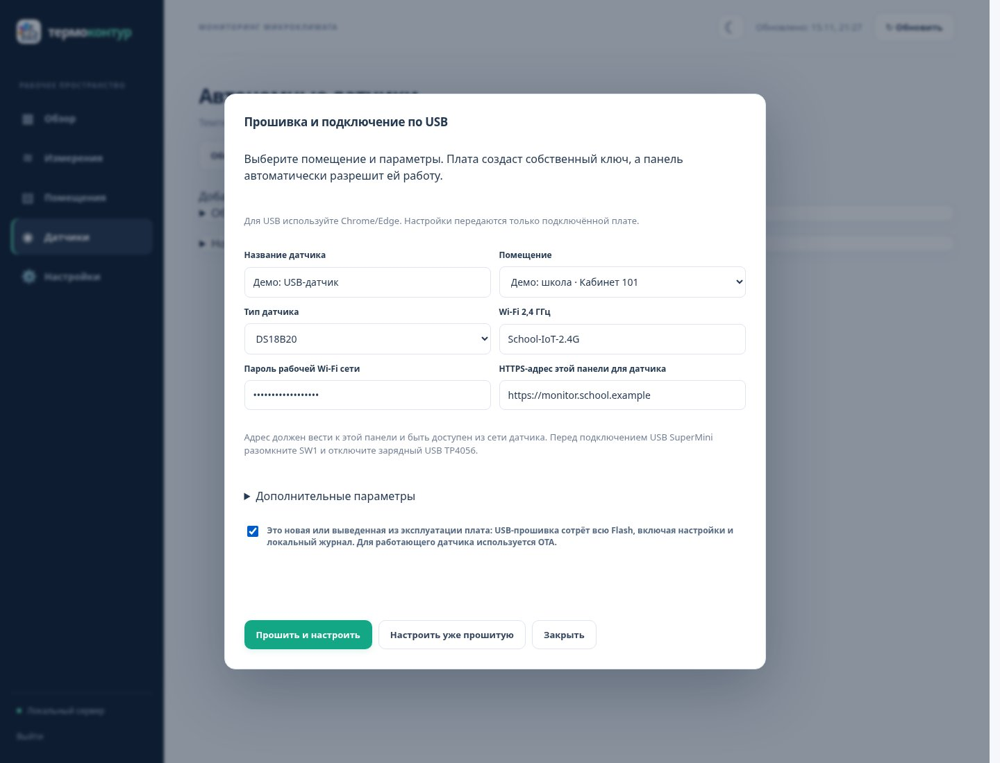

# Подключение датчика по USB

Для ESP32-C3 SuperMini с памятью 4 МБ и прошивкой 0.1.5 или новее. Поддерживаются DHT11, DHT22, SHT3x, SHT4x, AHT20, BME280, BMP280 и DS18B20.

## Подготовка

- Откройте панель по HTTPS в Chrome или Edge на компьютере и войдите как администратор.
- Добавьте хотя бы одно активное помещение.
- Подключите модуль по [схеме](SCHEMATICS.md).
- Разомкните SW1 и отключите USB зарядки TP4056. Затем подключите USB SuperMini кабелем с передачей данных.
- Закройте программы, занимающие USB-порт.

Не подавайте питание одновременно от аккумулятора и USB. Firefox, Safari и телефоны для этого мастера не подходят. Для локальной разработки доступен localhost; самому датчику всё равно нужен HTTPS.

## Выберите прошивку

Мастер по умолчанию выбирает прошивку из комплекта панели. Если нужен свой комплект, загрузите ZIP версии 0.1.5 или новее в **Датчики → Прошивки → Загрузить комплект ZIP для ESP32-C3**. Выберите загруженную версию в мастере. ZIP можно взять из артефакта GitHub Actions `termokontur-sensor-esp32c3`.

Чтобы собрать комплект самостоятельно, выполните из чистой копии репозитория:

```sh
python -m pip install platformio==6.1.18 esptool==4.5.1
python scripts/package-sensor.py
```

Файл `firmware.bin` предназначен для обновления работающих датчиков, а не для загрузки комплекта.

## Укажите параметры

Нажмите **Прошить и подключить по USB** и заполните:

- название и помещение;
- тип подключённого модуля;
- Wi-Fi 2,4 ГГц и пароль;
- HTTPS-адрес этой панели, доступный из сети датчика, например `https://monitor.school.example`.

BMP280 и DS18B20 передают только температуру. Поддерживаются WPA2-Personal и открытая сеть. Сети с корпоративным входом или страницей авторизации не поддерживаются.

В **Дополнительных параметрах** можно указать корневой сертификат PEM, сервер времени, пароль сети настройки и параметры измерений. Пустые поля пароля сохраняют прежний режим; новая плата использует случайный пароль. Требования к своему паролю: 8–63 латинских символа, цифры или знаки. Случайный пароль виден в USB-мониторе при входе в настройки.

Для быстрой проверки задайте измерения раз в 60 с, передачу раз в 600 с и паузу после зарядки 300 с. После проверки верните рабочие интервалы.



## Прошейте и настройте

Полная USB-прошивка удалит настройки, ключ и журнал платы. Используйте её для новой или выведенной из эксплуатации платы. Перед заменой сохраните данные и отключите прежнюю запись.

1. Подтвердите удаление данных.
2. Нажмите **Прошить и настроить** и выберите USB-порт ESP32-C3.
3. Дождитесь сообщения **Готово**. Не отключайте кабель во время записи.

Мастер проверяет плату и прошивку перед стиранием. С версии 1.1.4 он повторяет подключение после записи, проверяет сохранение параметров чтением NVS, только затем разрешает доступ и сверяет окончательные настройки. Плата остаётся в режиме настройки до команды завершения (или тайм-аута). Пароли и сертификат не возвращаются в журнал. Если браузер потерял разрешение на USB-порт, выберите «Настроить без прошивки» после короткого RESET. Старые прошивки используют прежний протокол без проверки NVS.


Если прошивка 0.1.5 или новее уже установлена, нажмите **Настроить без прошивки**. Этот способ сохраняет журнал и подходит для исправления сетевых настроек.

## Проверьте первые данные

1. Отключите USB SuperMini и USB зарядки TP4056.
2. Замкните SW1, чтобы включить питание от аккумулятора.
3. Откройте карточку датчика. Дождитесь статуса **Данные получены** и первых измерений.

Сообщение **Готово** подтверждает сохранение настроек и выдачу доступа. Связь по Wi-Fi подтверждается первыми данными в карточке. Если их нет, проверьте заряд, Wi-Fi, адрес панели, сертификат и сервер времени.

## Если подключение не удалось

| Проблема | Что сделать |
|---|---|
| Плата спит или порт отладки пропал | Оставьте кабель подключённым к USB-разъёму ESP32-C3, коротко нажмите RESET, затем выберите порт в отладке. |
| Мастер прошивки не видит плату | Проверьте кабель и права доступа. Для входа в загрузчик удерживайте BOOT, коротко нажмите RESET, отпустите BOOT и выберите порт заново. |
| Порт занят | Закройте USB-мониторы и другие вкладки с доступом к плате. |
| Порт изменился после записи | Нажмите **Настроить без прошивки** и выберите порт той же платы. |
| В журнале есть `charger input GPIO4 is LOW` | Отключите USB зарядки TP4056. При выключенной зарядке проверьте подтяжку GPIO4 к 3,3 В и схему детектора. |
| Мастер отклонил плату | Нужна ESP32-C3 с памятью не менее 4 МБ. |
| `Image file at 0x0 doesn't look like an image file` | В старой панели esptool-js мог выдавать это предупреждение при попытке изменить заголовок. С 1.1.2 мастер проверяет параметры заводского образа и сохраняет его заголовок без изменений. |
| Доступ выдан, настройки не сохранены | Повторите настройку без прошивки. Дубликат датчика не создаётся. |
| Нужно сменить тип модуля | Сначала передайте накопленные измерения на сервер. |
| Нужно сменить помещение | Сначала передайте накопленные данные, затем измените помещение в карточке. |

В **Датчики → Прошивки → Отладка прошивки** можно открыть журнал USB и проверить версию платы. Для чтения сведений и пробного замера подключите USB и запустите плату в режиме настройки. Если порт занят мастером, закройте его перед подключением на странице отладки. Пробный замер доступен с прошивки 1.0.0.

### Пробная отправка кнопкой BOOT

С панелью и прошивкой 1.1.0 настройте Wi-Fi и привязку к серверу. После сохранения плата засыпает и USB-порт пропадает. Закройте мастер, оставьте кабель USB подключённым и коротко нажмите только RESET. Откройте **Отладку прошивки** и выберите **Подключить USB → Отправить замер по BOOT**. Дождитесь приглашения в журнале и коротко нажмите BOOT на плате в течение пяти минут. Показания попадут в обычную историю датчика. В USB-журнале появится подтверждение сервера или причина сбоя.

При питании от компьютера порт остаётся открыт до конца пробы. Можно проверить пробуждение отдельно с подключённым аккумулятором. После приглашения в журнале отсоедините USB, дождитесь лёгкого сна и нажмите BOOT. Режим заканчивается после одной попытки либо по тайм-ауту, затем плата возвращается в глубокий сон. Для пробы от USB без аккумулятора панель должна быть обновлена до 1.1.0 или новее.

Можно использовать [настройку с телефона](SETUP.md). Без кода плата появится в списке **Ожидают разрешения**. Администратор сверяет плату и отпечаток ключа, выбирает помещение и нажимает **Разрешить**. Повторное подключение происходит через 5 минут.

## Доступ и проверки

У каждой платы собственный ключ. Закрытая часть остаётся на плате. Отозвать доступ можно в карточке; для повторного подключения потребуется разрешение администратора. Отключённые датчики и помещения не получают доступ.

Secure Boot и шифрование памяти не включены. Протокол описан в [PROTOCOL.md](PROTOCOL.md).

Скриншоты получены с имитацией платы. USB-запись, питание, радиосвязь и сон требуют проверки на физическом устройстве: [приёмка](BENCH.md), [результаты программных проверок](VALIDATION.md).

С прошивки **0.1.5** время и активный сертификат автоматически поступают с
HTTPS-сервера открытой панели перед сохранением на плате. Внешний NTP и дата
компьютера не используются. Адрес сервера показывает адрес открытой панели;
для другого сервера откройте его панель. После обновления сервера версия
из комплекта панели доступна для назначения в карточке датчика. При настройке по USB
выберите «Настроить без прошивки», чтобы передать время и сертификат без
стирания архива. Особенности TLS на reverse proxy описаны в [протоколе](PROTOCOL.md#время).

### Повторные пробные измерения (1.1.0)

В отладке выберите интервал 5, 10 или 30 секунд и нажмите «Запустить автозамер». Следующий запрос отправляется после завершения предыдущего. Счётчики показывают результат команд, включая тайм-ауты; журнал платы показывает попытки чтения и восстановление I²C. Тайм-аут USB — 15 секунд. Пробные замеры не отправляются на сервер. Для I²C нужны внешние подтяжки SDA/SCL к 3,3 В (обычно 4,7 кОм; проверьте модуль). Аппаратная стабильность требует проверки на реальной плате.

С версии 1.1.4 отключённые датчики и датчики без разрешения находятся в свёрнутом архиве; отклонённые заявки — в отдельном разделе. История измерений не удаляется. Для повторного подключения откройте архив или разрешите заявку.

### Запись настроек вместе с прошивкой (1.1.5)

Для новых заводских комплектов мастер записывает персональный блок настроек в отдельный раздел factory_setup (0x12000, 16 КиБ) вместе с образом, до перезапуска. Исходный скачанный ZIP не изменяется. При первом старте плата проверяет CRC и MAC, сохраняет настройки в NVS, проверяет чтение и стирает временный раздел. Сервер выдаёт одноразовое разрешение на 24 часа, привязанное к MAC и типу датчика; закрытый ключ генерируется платой, регистрация подтверждается подписью по HTTPS. Карточка появляется только после регистрации. При питании от USB без аккумулятора выполняется только регистрация, без измерения. При ошибке сети повтор через 5 минут; если разрешение истекло, воспользуйтесь ручной настройкой по USB. Для входа в неё удерживайте BOOT после RESET (не во время RESET). OTA-разделы и журнал не перемещены; старые платы и старые заводские комплекты сохраняют обычную USB-настройку. Flash не зашифрована; не публикуйте персонализированный образ и не передавайте одноразовое разрешение.

### Локальные домены и DNS (1.1.6)

Прошивка использует обычный DNS, в том числе для доменов Active Directory с окончанием `.local`. По умолчанию адреса DNS выдаёт DHCP. При необходимости в мастере USB или на странице настройки платы укажите основной и резервный IPv4-адрес DNS локальной сети. Не используйте публичные DNS для внутренних имён. Журнал выводит адреса DNS от DHCP, активные DNS, результат разрешения имени и отдельно ошибки HTTPS/HTTP/регистрации. Имя HTTPS-сервера остаётся прежним, проверка сертификата не отключается. Для уже настроенного датчика используйте «Настроить без прошивки» после обновления прошивки; стирать журнал не требуется. DNS-поля в старых прошивках не поддерживаются.

### Собственный центр сертификации (1.1.7)

Откройте «Настройки → HTTPS-сертификат → Сертификаты для датчиков», загрузите корневой CA (.cer/.crt/.pem/.der) и при необходимости промежуточные CA. Для встроенного HTTPS панель проверяет подписи активной цепочки до загруженного CA; для внешнего прокси проверка фактически выдаваемого сертификата остаётся на устройстве. Проверка имени и TLS на ESP32 не отключается. CA сохраняются в SQLite и автоматически попадают в bootstrap и заводские настройки. Перезапуск панели не требуется. При несовпадении встроенной цепочки bootstrap блокирует настройку до исправления CA. Уже прошитые платы, не доверяющие серверу, требуют настройки по USB или новой заводской прошивки. В журнале ESP32 выводятся время, размер CA и доступные флаги проверки TLS. Не загружайте закрытые ключи УЦ.
