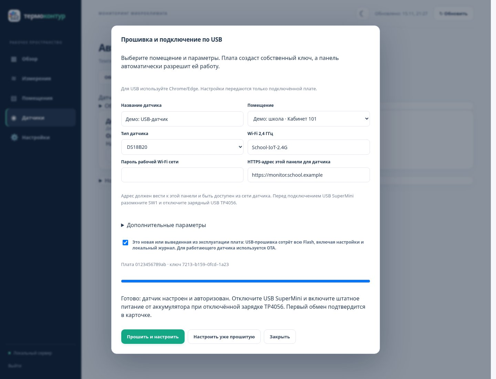

# Подключение датчика по USB

Для ESP32-C3 SuperMini с памятью 4 МБ и прошивкой 0.1.5 или новее. Поддерживаются DHT11, DHT22, SHT3x, SHT4x, AHT20, BME280 и DS18B20.

## Подготовка

- Откройте панель по HTTPS в Chrome или Edge на компьютере и войдите как администратор.
- Добавьте хотя бы одно активное помещение.
- Подключите модуль по [схеме](SCHEMATICS.md).
- Разомкните SW1 и отключите USB зарядки TP4056. Затем подключите USB SuperMini кабелем с передачей данных.
- Закройте программы, занимающие USB-порт.

Не подавайте питание одновременно от аккумулятора и USB. Firefox, Safari и телефоны для этого мастера не подходят. Для локальной разработки доступен localhost; самому датчику всё равно нужен HTTPS.

## Загрузите прошивку

В **Датчики → Комплект USB-прошивки** загрузите ZIP версии 0.1.5 или новее из артефакта GitHub Actions `termokontur-sensor-esp32c3`. Распаковывать его не нужно. Один комплект подходит для всех новых плат.

Чтобы собрать комплект самостоятельно, выполните из чистой копии репозитория:

```sh
python -m pip install platformio==6.1.18 esptool==4.5.1
python scripts/package-sensor.py
```

Файл `firmware.bin` предназначен для обновления работающих датчиков, а не для загрузки комплекта.

## Укажите параметры

Нажмите **Прошить и подключить по USB** и заполните:

- название и помещение;
- тип подключённого модуля;
- Wi-Fi 2,4 ГГц и пароль;
- HTTPS-адрес этой панели, доступный из сети датчика, например `https://monitor.school.example`.

DS18B20 измеряет только температуру. Поддерживаются WPA2-Personal и открытая сеть. Сети с корпоративным входом или страницей авторизации не поддерживаются.

В **Дополнительных параметрах** можно указать корневой сертификат PEM, сервер времени, пароль сети настройки и параметры измерений. Пустые поля пароля сохраняют прежний режим; новая плата использует случайный пароль. Требования к своему паролю: 8–63 латинских символа, цифры или знаки. Случайный пароль виден в USB-мониторе при входе в настройки.

Для быстрой проверки задайте измерения раз в 60 с, передачу раз в 600 с и паузу после зарядки 300 с. После проверки верните рабочие интервалы.


## Прошейте и настройте

Полная USB-прошивка удалит настройки, ключ и журнал платы. Используйте её для новой или выведенной из эксплуатации платы. Перед заменой сохраните данные и отключите прежнюю запись.

1. Подтвердите удаление данных.
2. Нажмите **Прошить и настроить** и выберите USB-порт ESP32-C3.
3. Дождитесь сообщения **Готово**. Не отключайте кабель во время записи.

Мастер проверяет плату и прошивку перед стиранием. Доступ выдаётся автоматически; код и отдельное разрешение администратора не нужны. Параметры Wi-Fi передаются по USB.



Если прошивка 0.1.5 или новее уже установлена, нажмите **Настроить без прошивки**. Этот способ сохраняет журнал и подходит для исправления сетевых настроек.

## Проверьте первые данные

1. Отключите USB SuperMini и USB зарядки TP4056.
2. Замкните SW1, чтобы включить питание от аккумулятора.
3. Откройте карточку датчика. Дождитесь статуса **Данные получены** и первых измерений.

Сообщение **Готово** подтверждает сохранение настроек и выдачу доступа. Связь по Wi-Fi подтверждается первыми данными в карточке. Если их нет, проверьте заряд, Wi-Fi, адрес панели, сертификат и сервер времени.

## Если подключение не удалось

| Проблема | Что сделать |
|---|---|
| Порт не появился | Проверьте кабель и права доступа. Удерживайте BOOT, нажмите RESET, отпустите BOOT и выберите порт заново. |
| Порт занят | Закройте USB-мониторы и другие вкладки с доступом к плате. |
| Порт изменился после записи | Нажмите **Настроить без прошивки** и выберите порт той же платы. |
| Мастер отклонил плату | Нужна ESP32-C3 с памятью не менее 4 МБ. |
| Доступ выдан, настройки не сохранены | Повторите настройку без прошивки. Дубликат датчика не создаётся. |
| Нужно сменить тип модуля | Сначала передайте накопленные измерения на сервер. |
| Нужно сменить помещение | Сначала передайте накопленные данные, затем измените помещение в карточке. |

Можно использовать [настройку с телефона](SETUP.md). Без кода плата появится в списке **Ожидают разрешения**. Администратор сверяет плату и отпечаток ключа, выбирает помещение и нажимает **Разрешить**. Повторное подключение происходит через 5 минут.

## Доступ и проверки

У каждой платы собственный ключ. Закрытая часть остаётся на плате. Отозвать доступ можно в карточке; для повторного подключения потребуется разрешение администратора. Отключённые датчики и помещения не получают доступ.

Secure Boot и шифрование памяти не включены. Протокол описан в [PROTOCOL.md](PROTOCOL.md).

Скриншоты получены с имитацией платы. USB-запись, питание, радиосвязь и сон требуют проверки на физическом устройстве: [приёмка](BENCH.md), [результаты программных проверок](VALIDATION.md).

С прошивки **0.1.5** время и активный сертификат автоматически поступают с
HTTPS-сервера открытой панели перед сохранением на плате. Внешний NTP и дата
компьютера не используются. Адрес сервера показывает адрес открытой панели;
для другого сервера откройте его панель. После установки обновления сервера
загрузите комплект прошивки 0.1.5 и обновите датчики. При настройке по USB
выберите «Настроить без прошивки», чтобы передать время и сертификат без
стирания архива. Особенности TLS на reverse proxy описаны в [протоколе](PROTOCOL.md#время).
